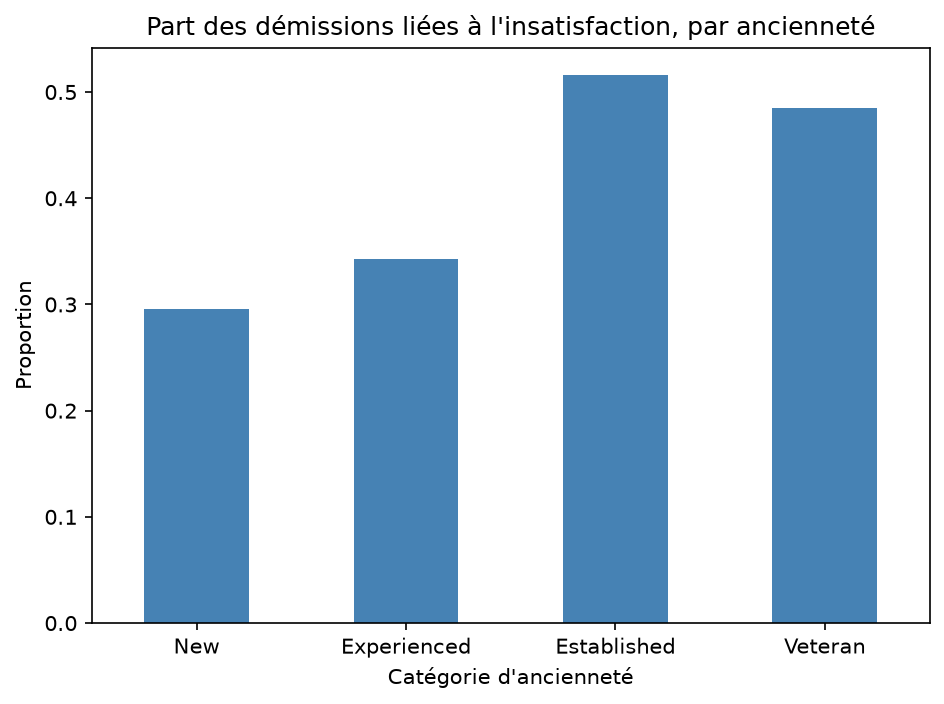
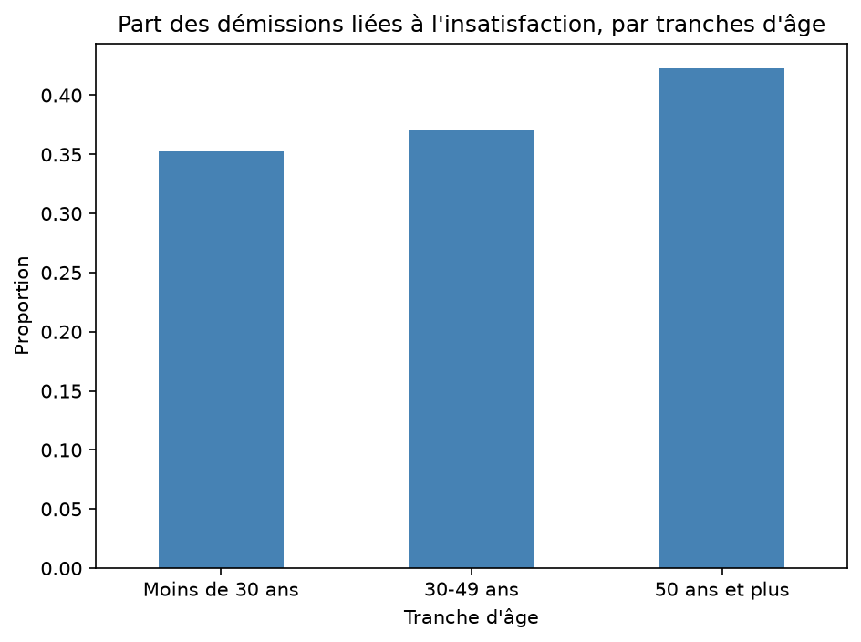

# Nettoyage et analyse des enquêtes de sortie DETE & TAFE (Queensland, Australie)

## Contexte
Deux enquêtes de sortie auprès d'employés du Department of Education, Training and
Employment (DETE) et du Technical and Further Education Institute (TAFE) du Queensland.
Les deux utilisent le même modèle, mais l'une a personnalisé certaines réponses :
les données ne sont donc pas directement comparables.

## Questions posées
1. Les employés ayant peu d'ancienneté démissionnent-ils par insatisfaction ? Et ceux qui
   travaillent là depuis longtemps ?
2. Les jeunes employés démissionnent-ils par insatisfaction ? Et les plus âgés ?

## Méthodologie de nettoyage
- Chargement des deux jeux de données (valeurs « Not Stated » converties en valeurs manquantes)
- Suppression des colonnes inutiles à l'analyse
- Harmonisation des noms de colonnes entre les deux enquêtes
- Filtrage des démissions (« Resignation »)
- Extraction et conversion de l'année de départ ; calcul de l'ancienneté pour DETE
- Création d'une colonne `dissatisfied` à partir de plusieurs facteurs d'insatisfaction
  (True / False / NaN), avec des règles propres à chaque enquête
- Fusion des deux jeux de données (`pd.concat`) et suppression des colonnes trop incomplètes
- Extraction numérique de l'ancienneté et regroupement en catégories :
  New (<3 ans), Experienced (3-6), Established (7-10), Veteran (11+)
- Traitement des valeurs manquantes de `dissatisfied` (remplacées par False)

## Résultats clés
- Ancienneté : 30 % des démissions des employés de la catégorie New 
  sont liées à l'insatisfaction, contre 34 % pour les employés de la catégorie Experienced, 52 % pour les employés de la catégorie Established et 49 % pour ceux de la catégorie Veteran
- Âge : 35 % des démissions des employés de moins de 30 ans
  sont liées à l'insatisfaction, contre 37 % pour les employés de la plage de 30 à 49 ans et 42 % pour les employés qui ont 50 ans et plus 

## Lancer le projet
pip install pandas numpy matplotlib
python analyse.py